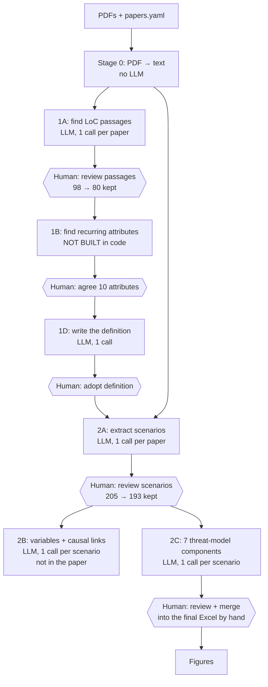

The flow at a glance

Hexagons are **human steps**. The code never produces their outputs; a person writes those files.

## Each step: what it needs and what it produces

| Step                                                             | What it does                                                                                                                        | Needs as input                                          | Produces                                                                                                               | Paper's settings                                                                            |
| ---------------------------------------------------------------- | ----------------------------------------------------------------------------------------------------------------------------------- | ------------------------------------------------------- | ---------------------------------------------------------------------------------------------------------------------- | ------------------------------------------------------------------------------------------- |
| **0. Extract text** (`src/extract_text.py`, notebook 01) | Converts each PDF to plain text.**Free, no LLM**                                                                              | `papers.yaml` + PDFs in `papers/` (exact filenames) | `raw_text/<paper_id>.txt`                                                                                            | —                                                                                          |
| **1A. Definition passages** (`run_1a`, notebook 02)      | Finds passages that use the seed terms ("loss of control", …)                                                                      | `raw_text/`, `seed_terms_v2.yaml`, prompt, HF token | `stages/1a_definition_extraction/experiments/<name>/outputs/*.json` + review docs, `summary.csv`, quote check      | Kimi K2.5,`prompt_1a_v2`, seed terms **v2**. ⚠ The notebook defaults to Llama / v1 |
| ↳*Human*                                                      | Check each passage against the paper; drop the irrelevant ones                                                                      | 1A review docs                                          | `stages/1a…/verified/consolidated_verified.json` (98 → 80 kept)                                                    | —                                                                                          |
| **1B. Attributes** (`run_1b`, notebook 03)               | Should find the recurring attributes across passages.**Not implemented**: it raises an error, so it was done outside the code | verified 1A passages,`prompt_1b_v1`                   | (nothing)                                                                                                              | —                                                                                          |
| ↳*Human*                                                      | Three reviewers agreed on the 10 attributes                                                                                         | 1B output                                               | `stages/1d_definition_synthesis/verified/verified_attributes.txt` (one per line)                                     | **Listed in paper App. D**                                                            |
| **1D. Definition** (`run_1d`, notebook 04)               | Turns the 10 attributes into one operational definition                                                                             | `verified_attributes.txt`, `prompt_1d_v1`           | `stages/1d…/experiments/<name>/output.json`                                                                         | Kimi K2.5                                                                                   |
| ↳*Human*                                                      | Adopt the definition text                                                                                                           | 1D output                                               | `stages/1d…/verified/definition.txt`                                                                                | **Printed in paper §2.2.2**                                                          |
| **2A. Scenarios** (`run_2a`, notebook 05)                | Extracts LoC scenarios from each paper, using the definition as the filter                                                          | `raw_text/`, `definition.txt`, `prompt_2a_v1`     | `stages/2a_scenario_extraction/experiments/<name>/outputs/*.json` + review docs, quote check                         | Kimi K2.5, 205 candidates                                                                   |
| ↳*Human*                                                      | Remove non-scenarios and duplicates                                                                                                 | 2A review docs                                          | `stages/2a…/verified/consolidated_verified.json`: a list of `{paper_id, scenario_id, scenario_text}` (205 → 193) | **= Excel `Sheet1`**                                                                |
| **2B. Variables** (`run_2b`, notebook 06)                | For each scenario: variables, cause → effect links, +/− polarity                                                                  | `consolidated_verified.json`, `prompt_2b_v1`        | `stages/2b_variable_identification/…`                                                                               | Not in the paper; feeds phase 2                                                             |
| **2C. Threat model** (`run_2c`, notebook 07)             | For each scenario: the 7 components + evidence + Clear/Ambiguous/Not specified                                                      | `consolidated_verified.json`, `prompt_2c_v2`        | `stages/2c_threat_model/…`                                                                                          | Kimi K2.5,`prompt_2c_v2`                                                                  |
| ↳*Human*                                                      | Review the 2C output and**merge by hand** into the final Excel. No code writes it; I checked                                  | 2A + 2C outputs                                         | `stages/scenario_final_resolved.xlsx`                                                                                | Your`materials/` copy                                                                     |
| **Figures** (`figures/generate_figures.py`)              | Paper figures 1–3                                                                                                                  | the final Excel +`paper_labels.yaml`                  | `figures/*.png/pdf`. ⚠ It **overwrites** the tracked files                                                    | —                                                                                          |

## LLM calls per stage (where the cost is)

| Stage | Calls | Input per call                |
| ----- | ----- | ----------------------------- |
| 1A    | 31    | a**whole paper** (long) |
| 1D    | 1     | short                         |
| 2A    | 31    | a**whole paper** (long) |
| 2B    | 193   | one scenario (short)          |
| 2C    | 193   | one scenario (short)          |

1A and 2A are the expensive ones; 2B and 2C are many cheap calls.

## The key point for planning

You already hold the outputs of **every human step** after 1A:

- the 10 attributes (paper Appendix D)
- the definition (paper §2.2.2)
- the 193 verified scenarios (Excel `Sheet1`)

So you **don't have to rerun everything** to do useful work. Three routes:

| Goal                                                                  | Start at                                        | Needs                                                                                                               |
| --------------------------------------------------------------------- | ----------------------------------------------- | ------------------------------------------------------------------------------------------------------------------- |
| **Context check** (the reviewers' concern about short passages) | Stage 0 only, plus finding passages in the text | PDFs. No token, no LLM                                                                                              |
| **Cross-model check** (paper limitation: only one model)        | 2C with another model, on the fixed 193         | 193 scenarios from the Excel + token                                                                                |
| **Phase 2 seed** (causal links)                                 | 2B on the fixed 193                             | same                                                                                                                |
| **Full reproduction**                                           | Stage 0 → 1A → …                             | PDFs, token, and time for every human review. Numbers will differ slightly, because LLMs aren't fully deterministic |

**What every route needs first:**

1. The PDFs, renamed to match `papers.yaml`.
2. A local way to run stages (the notebooks only work in Colab).
3. The known bug fixes (`run_2b`/`run_2c` crash on list replies).
